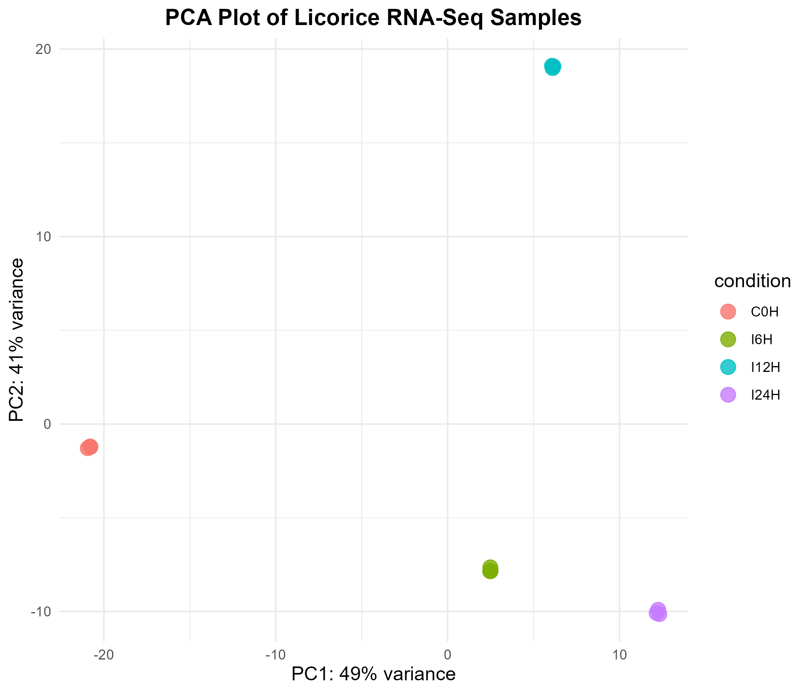
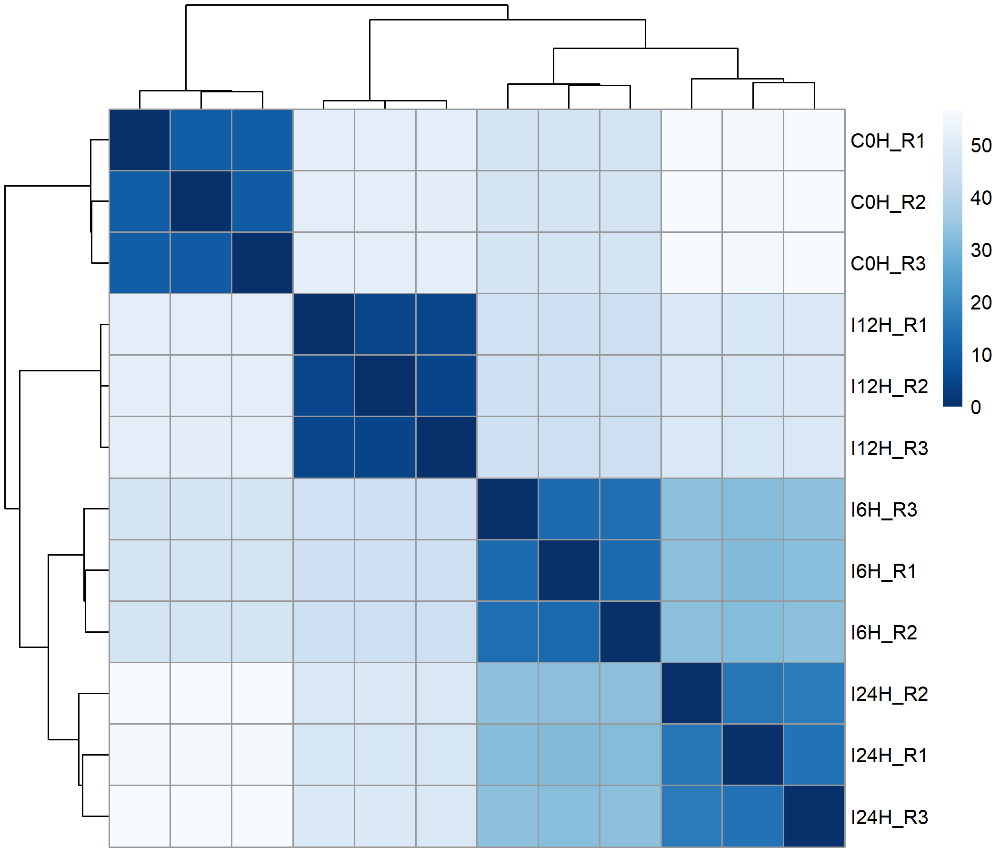
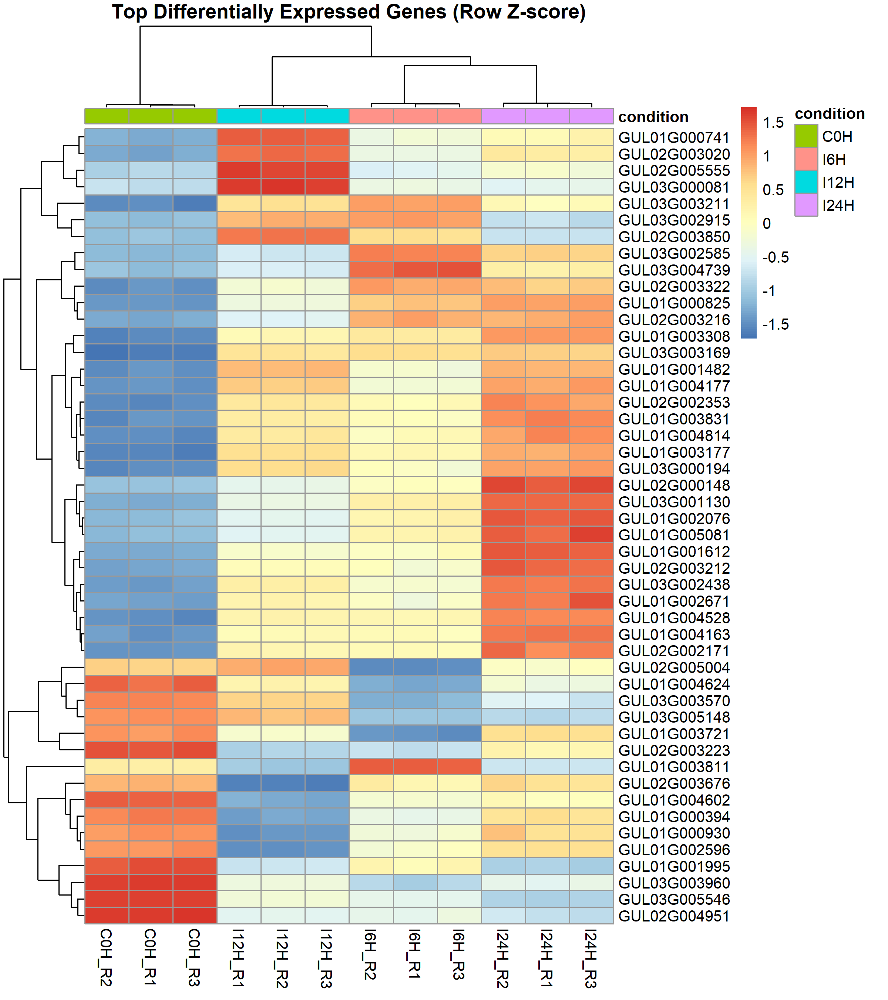
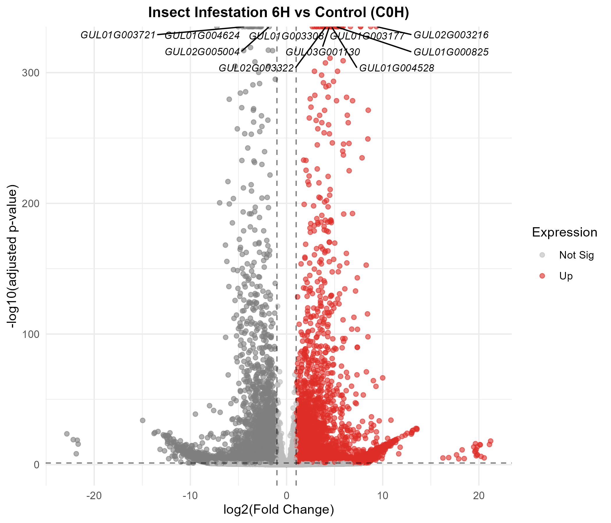
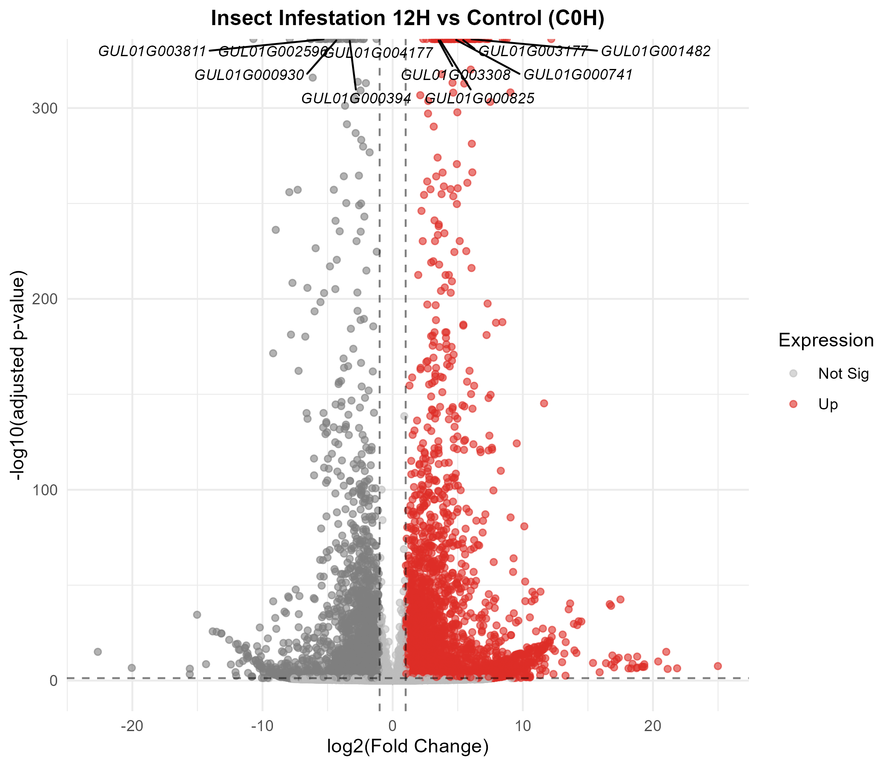
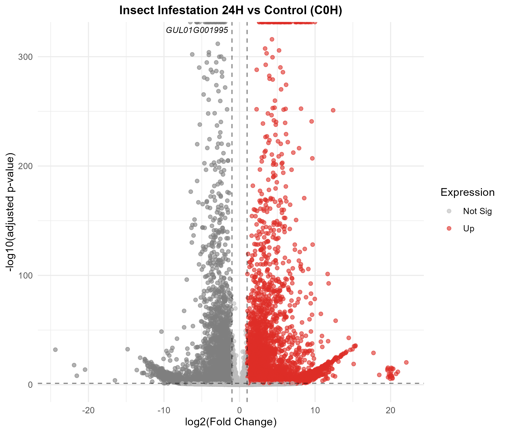

# Time-course RNA-seq analysis of licorice response to insect infestation

This repository contains an RNA-seq analysis of licorice (*Glycyrrhiza uralensis*) leaf samples collected over a 24-hour insect-infestation time course. It includes a per-sample Bash script for read processing and gene counting, R scripts for differential expression and downstream annotation, and the project’s reported tables and visualizations.

The checked-in Bash script processes one sample per invocation. The later Arabidopsis homology, GO/KEGG, and candidate-gene analyses are separate downstream steps; they are not part of that Bash script. Analysis outputs are computational results and do not by themselves establish experimental or biochemical effects.

## Study design and sequence accessions

The design has 12 paired-end samples: three biological replicates for each of four conditions (control and 6, 12, and 24 hours after infestation). Sample identifiers and accessions below match [`samples.txt`](samples.txt).

| Condition | Sample | SRA run |
| --- | --- | --- |
| Control (0 h) | `C0H_R1` | [SRR38388773](https://www.ncbi.nlm.nih.gov/sra/SRR38388773) |
| Control (0 h) | `C0H_R2` | [SRR38388772](https://www.ncbi.nlm.nih.gov/sra/SRR38388772) |
| Control (0 h) | `C0H_R3` | [SRR38388769](https://www.ncbi.nlm.nih.gov/sra/SRR38388769) |
| 6 h infestation | `I6H_R1` | [SRR38388768](https://www.ncbi.nlm.nih.gov/sra/SRR38388768) |
| 6 h infestation | `I6H_R2` | [SRR38388767](https://www.ncbi.nlm.nih.gov/sra/SRR38388767) |
| 6 h infestation | `I6H_R3` | [SRR38388766](https://www.ncbi.nlm.nih.gov/sra/SRR38388766) |
| 12 h infestation | `I12H_R1` | [SRR38388765](https://www.ncbi.nlm.nih.gov/sra/SRR38388765) |
| 12 h infestation | `I12H_R2` | [SRR38388764](https://www.ncbi.nlm.nih.gov/sra/SRR38388764) |
| 12 h infestation | `I12H_R3` | [SRR38388763](https://www.ncbi.nlm.nih.gov/sra/SRR38388763) |
| 24 h infestation | `I24H_R1` | [SRR38388762](https://www.ncbi.nlm.nih.gov/sra/SRR38388762) |
| 24 h infestation | `I24H_R2` | [SRR38388771](https://www.ncbi.nlm.nih.gov/sra/SRR38388771) |
| 24 h infestation | `I24H_R3` | [SRR38388770](https://www.ncbi.nlm.nih.gov/sra/SRR38388770) |

## Workflow

The analysis sequence is:

1. Retrieve SRA runs and convert paired-end reads to FASTQ.
2. Run FastQC on raw reads; trim with Trim Galore; run FastQC on trimmed reads.
3. Align reads to the licorice reference with HISAT2; convert, sort, and index alignments with SAMtools.
4. Count features with Subread `featureCounts`.
5. Use DESeq2 for three treatment-versus-control comparisons and generate expression plots.
6. Separately map predicted licorice proteins to Arabidopsis proteins with DIAMOND, then run GO and KEGG over-representation analyses.
7. Separately use Arabidopsis annotations and keyword rules to produce candidate defense-gene lists.

The checked-in shell script performs steps 1–4 for one sample. It does not run MultiQC, the R analyses, or the DIAMOND protein search. The protein-search input expected by the enrichment script is not tracked in this repository.

## Reproducing read processing and gene counting

Run these commands from the repository root in a Linux environment such as WSL2. The script expects its output directories to exist and assumes that `prefetch` creates an `$SRR` directory containing `$SRR.sra`. That assumption depends on SRA Toolkit behavior and should be checked in the local environment. The script does not check or create the directories, validate reference files, or verify that all external commands are installed.

Create the output directories before running:

```bash
mkdir -p raw_data qc trimmed qc_trimmed alignments counts
```

Place the reference annotation at `reference/GWH_reference/annotation.gff` and provide a HISAT2 index with prefix `reference/GWH_reference/hisat2_index/licorice` (the corresponding index files use that prefix). The repository’s `.gitignore` excludes most of `reference/`; these files must be obtained and prepared separately. The README and scripts do not record an exact assembly release, download URL, checksum, or index-build command, so confirm that the annotation and index come from the same GWH *G. uralensis* cultivar Manju assembly before analysis.

Run the script once for each sample. These are the sample/accession pairs in `samples.txt`:

```bash
bash scripts/run_rnaseq_pipeline.sh C0H_R1 SRR38388773
bash scripts/run_rnaseq_pipeline.sh C0H_R2 SRR38388772
bash scripts/run_rnaseq_pipeline.sh C0H_R3 SRR38388769

bash scripts/run_rnaseq_pipeline.sh I6H_R1 SRR38388768
bash scripts/run_rnaseq_pipeline.sh I6H_R2 SRR38388767
bash scripts/run_rnaseq_pipeline.sh I6H_R3 SRR38388766

bash scripts/run_rnaseq_pipeline.sh I12H_R1 SRR38388765
bash scripts/run_rnaseq_pipeline.sh I12H_R2 SRR38388764
bash scripts/run_rnaseq_pipeline.sh I12H_R3 SRR38388763

bash scripts/run_rnaseq_pipeline.sh I24H_R1 SRR38388762
bash scripts/run_rnaseq_pipeline.sh I24H_R2 SRR38388771
bash scripts/run_rnaseq_pipeline.sh I24H_R3 SRR38388770
```

The script uses 8 threads for read conversion, alignment, and counting. It writes per-sample raw reads under `raw_data/`, QC reports under `qc/` and `qc_trimmed/`, trimmed reads under `trimmed/`, and featureCounts tables under `counts/`. It removes intermediate SAM/BAM files after counting. Raw reads and QC reports are retained. Check the script’s expected SRA download layout before processing all samples; its `mv $SRR raw_data/$SAMPLE` step can fail if `prefetch` has placed the run elsewhere.

### Required software and inputs

The Bash script calls SRA Toolkit (`prefetch`, `fasterq-dump`), FastQC, Trim Galore, HISAT2, SAMtools, and Subread (`featureCounts`). The R scripts require R and the packages `DESeq2`, `ggplot2`, `ggrepel`, `pheatmap`, `RColorBrewer`, `clusterProfiler`, `org.At.tair.db`, and `enrichplot`. The separate protein-mapping step uses `gffread` and DIAMOND. Exact software and package versions are not pinned in the repository; record versions from the environment used for any new analysis.

The required genome assembly, annotation, HISAT2 index, and Arabidopsis protein reference are not fully bundled. The annotation GFF is the only reference item allowed through the current `.gitignore` pattern; most reference files and the DIAMOND result `results/gwh_vs_arabidopsis.tsv` are ignored. SRA reads are downloaded rather than stored in Git.

## Differential expression and downstream analyses

The metadata in [`metadata/sample_info.csv`](metadata/sample_info.csv) provides sample IDs and conditions. The DESeq2 script expects one featureCounts table per sample at `counts/<sample>_counts.txt`. It skips the featureCounts comment line, uses column 1 as the gene ID and column 7 as the count value, merges the tables by gene ID, and retains genes with at least 10 total counts across all samples. Its design is `~ condition`, with `C0H` as the reference, and it tests `I6H`, `I12H`, and `I24H` against `C0H`.

The script writes full result tables and filtered DEG tables to `results/`. The implemented DEG filter is adjusted p-value < 0.05 and absolute log2 fold change > 1 (strictly greater than 1). It also creates a variance-stabilized PCA, sample-distance heatmap, volcano plots, and a heatmap of selected genes.

The R scripts contain a hard-coded Windows/WSL project path that is applied when R reports Windows as the operating system. On another machine, run them from the project root in an environment where that path branch is not used, or adapt the path locally. The scripts are run in this order after counts are available:

```bash
Rscript deseq2_analysis.R
```

The homology and enrichment analysis requires a DIAMOND tabular output file at `results/gwh_vs_arabidopsis.tsv` with the 12 standard fields expected by `go_kegg_enrichment.R` (query/subject IDs, identity, alignment statistics, E-value, and bitscore). This file is not generated by the checked-in Bash script, and the repository does not provide a complete command or all reference inputs to recreate it. Once that file is prepared, run:

```bash
Rscript go_kegg_enrichment.R
Rscript extract_key_genes.R
```

The enrichment script filters hits at E-value ≤ 1e-5 and identity ≥ 30%, then keeps the highest-bitscore Arabidopsis hit per licorice query. This is a single best-hit homology mapping, not evidence of reciprocal or one-to-one orthology. GO and KEGG analyses use those mapped Arabidopsis IDs; the script does not specify a custom background universe. Candidate gene groups are assigned from Arabidopsis annotation text using keyword rules. These outputs are computationally inferred candidates, not experimentally validated functions or hormone activity.

## Reported results

The existing project reports the following significant DEG totals for the treatment-versus-control comparisons:

| Contrast | Total DEGs | Up | Down | Mapped Arabidopsis IDs reported |
| --- | ---: | ---: | ---: | ---: |
| I6H vs C0H | 8,629 | 4,305 | 4,324 | 7,452 |
| I12H vs C0H | 7,818 | 4,379 | 3,439 | 6,803 |
| I24H vs C0H | 9,819 | 4,967 | 4,852 | 8,510 |

The mapped-ID counts are reported project values and should not be interpreted as unique ortholog counts without resolving possible many-to-one mappings. Genes without a retained Arabidopsis best hit are unmapped in this analysis; absence of a hit does not establish that a gene is novel or species-specific.

The existing results also report over-representation of categories associated with flavonoid biosynthesis, ribosome, photosynthesis, and other pathways. Enrichment indicates over-representation among the tested mapped gene list under the analysis settings; it does not demonstrate pathway activation, metabolite production, or a causal defense mechanism. Similarly, transcription-factor and hormone-related lists are annotation-based candidate sets.

The checked-in results and figures are presented as the project’s existing analysis outputs and have not been recomputed as part of this documentation update. Results should be re-evaluated if the analysis code, reference inputs, or software environment changes.

### Visualizations

The following existing figures are stored in `results/`:

<p align="center">
  
  
</p>

<p align="center">
  
</p>

<p align="center">
  
  
  
</p>

The repository also contains a proposed biological response model at [`results/biological_model_summary.png`](results/biological_model_summary.png). It is an interpretation of the transcriptomic analysis, not a direct measurement of metabolites or pathway activity.

## Repository contents

- `scripts/run_rnaseq_pipeline.sh`: per-sample SRA-to-featureCounts Bash script.
- `samples.txt`: sample, time point, and SRA run mapping.
- `metadata/sample_info.csv`: sample conditions used by DESeq2.
- `counts/`: tracked featureCounts tables used by the analysis.
- `deseq2_analysis.R`: differential expression and QC plots.
- `go_kegg_enrichment.R`: best-hit mapping and GO/KEGG over-representation analysis.
- `extract_key_genes.R`: keyword-based candidate-gene annotation.
- `results/`: existing tables and visualizations.
- `Nature_Mode_Results.md`: project narrative and interpretation.
- `.gitignore`: excludes downloaded raw reads, trimmed reads, alignment/QC intermediates, most reference resources, and the DIAMOND tabular mapping input.

## Scope and reproducibility limitations

This repository documents the original analysis but does not currently provide a fully self-contained, version-pinned end-to-end workflow. In particular, reference provenance and checksums, a reproducible environment specification, automated directory and dependency checks, the exact DIAMOND invocation and protein database, and a custom enrichment background are not supplied. The scripts also use a hard-coded local path in Windows R and assume particular count-table and SRA output layouts. These limitations should be addressed before treating the analysis as a portable production workflow.

No scripts, count tables, result tables, figures, or biological conclusions were changed for this README update.
